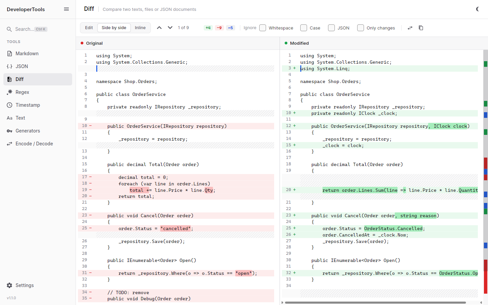
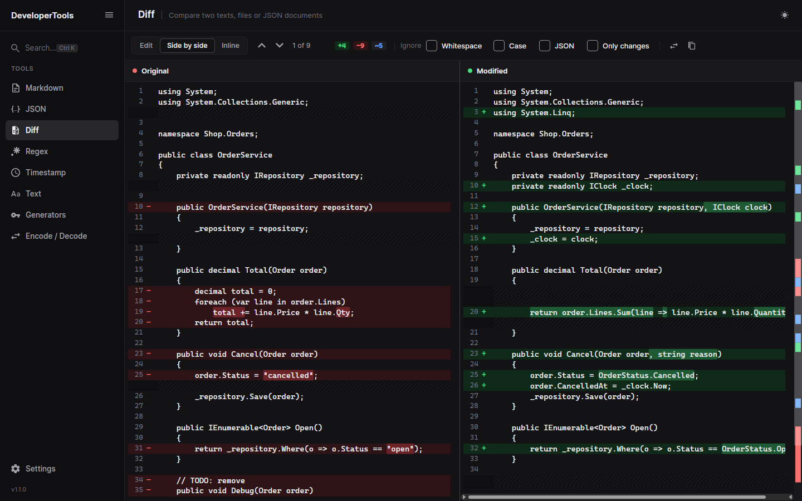
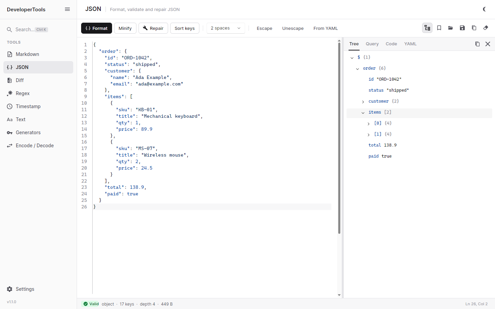
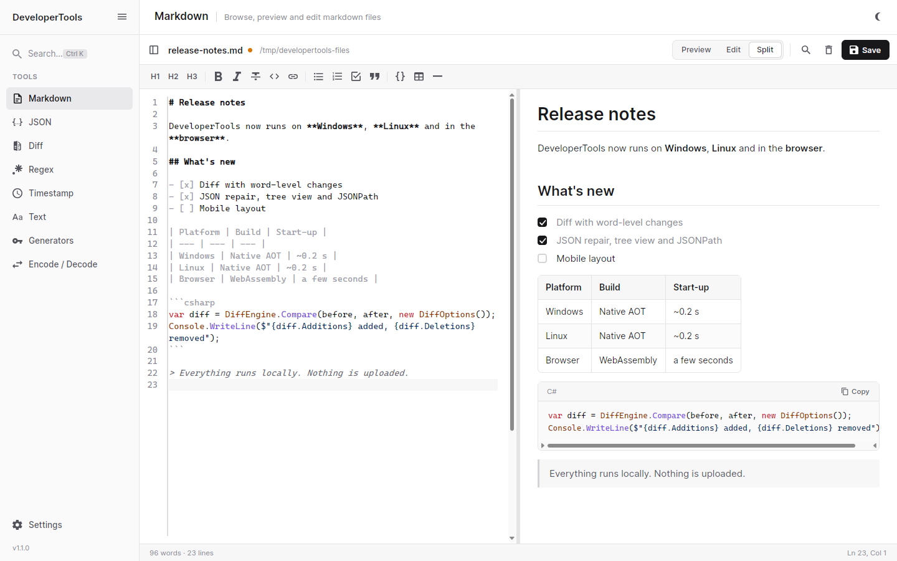
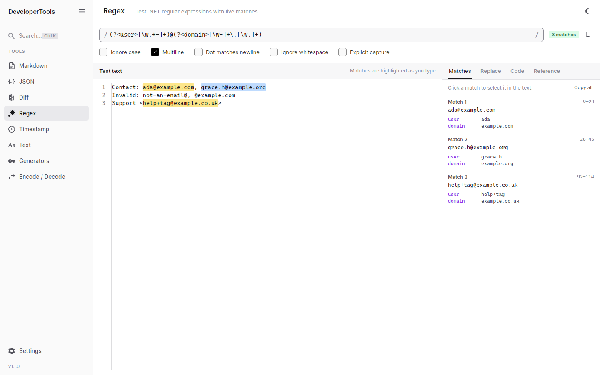
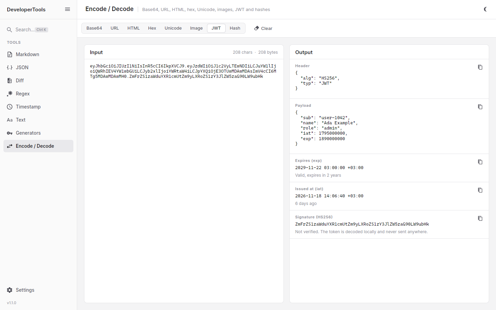
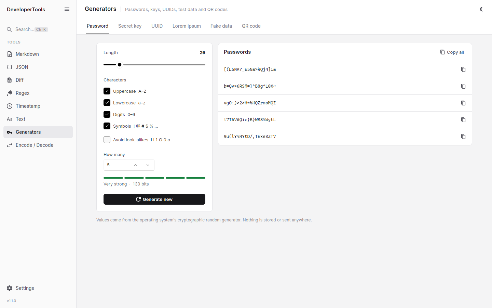
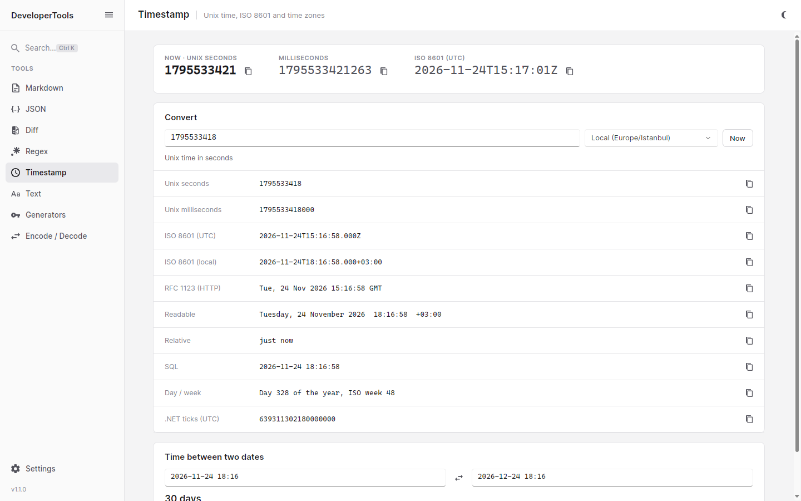
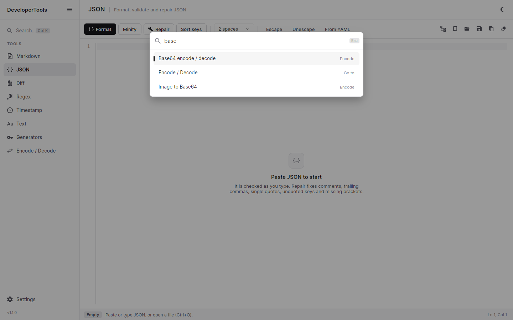

# DeveloperTools

DeveloperTools is a small, fast toolbox for the things developers do all day: reading Markdown notes,
cleaning up JSON, comparing two versions of a file, testing a regex, converting a timestamp, decoding a JWT
or generating a password. Instead of pasting your data into a different website for each of these, you get
them all in one app that works the same on **Windows**, **Linux** and **in your browser**.

Everything happens on your own computer. Nothing you paste, open or generate is sent anywhere.

**Try it now in your browser: https://sezerakr.github.io/DeveloperTools/**



## What's inside

### Diff: see exactly what changed

Paste two texts or open two files (you can also drop them onto the window) and DeveloperTools lines them up
side by side. Changed lines are tinted, and inside each line only the words that actually changed are
highlighted, so a renamed variable doesn't make the whole line light up. You can switch to an inline view,
ignore whitespace or letter case, fold away the unchanged parts, and jump between changes with F7.
When both sides are JSON, the **JSON** option formats and sorts them first, so you only see real data changes.
The strip on the right is a map of the whole file. Click it to jump anywhere. When you're done,
**Copy patch** gives you a git-style diff.



### JSON: format, check and fix

Paste JSON and it is formatted and checked as you type. If something is wrong, you're told where and why in
plain words ("Comments are not allowed in JSON", "Property names must be in double quotes"), and the exact spot
is underlined. **Repair** fixes the usual suspects for you: trailing commas, comments, single quotes,
unquoted keys, missing commas and brackets, `True`/`None`, and even a JSON blob pasted from a Markdown code block.

The side panel shows the data as a **tree**, runs **JSONPath queries** such as `$..items[?(@.price > 20)]`,
generates **C#, Kotlin or TypeScript** classes from your sample, and converts to and from **YAML**.



### Markdown: notes and docs, previewed properly

Point the desktop app at the folders where you keep `.md` files and browse them in an explorer. Read them in
a clean preview, edit with a toolbar and shortcuts, or use split view to do both. Code blocks are
highlighted for C#, Kotlin, JavaScript, Python, SQL and more, task checkboxes can be ticked right in the
preview, and Ctrl+F marks every match on the scrollbar. In the browser you open and save single files instead.



### Regex: test patterns against real text

Type a .NET regular expression and every match lights up in your sample text while you type. The side panel
lists each match with its named groups, previews a replace, gives you ready-to-paste C# and JavaScript code,
and has a short cheat sheet. Patterns that would hang (catastrophic backtracking) are stopped after two seconds.



### Encode / Decode

Convert Base64, URL encoding, HTML entities, hex and Unicode escapes in either direction, turn images into
Base64 or data URIs (and back), compute SHA and HMAC hashes, and **decode JWTs**: the header and payload are
shown as formatted JSON, and expiry dates are turned into real dates ("Valid, expires in 2 years").
Tokens are only decoded, never verified or sent anywhere.



### Generators

Strong passwords with a strength meter, secret keys in hex, Base64 or URL-safe formats (with presets for API keys,
JWT secrets and AES keys), UUID v4 and time-ordered v7, Lorem ipsum, fake test data (clearly fake: example.com
emails, 555 phone numbers, documentation IP ranges) and QR codes, including Wi-Fi QR codes. All randomness
comes from the operating system's cryptographic generator.



### Timestamp and Text

**Timestamp** reads Unix seconds, milliseconds, ISO 8601 or a plain date like `01.05.2024 10:00`, shows it in
ten formats and any time zone, and tells you how much time lies between two dates.
**Text** changes case (camelCase, snake_case, kebab-case and more), sorts and de-duplicates lines,
and counts characters, words and reading time.



### Small things that add up

- **Ctrl+K** opens a command palette: type a few letters to jump to any tool or action.
- A **light and dark theme**, switchable from the top-right corner.
- **Snippets** let you save an input (a regex, a JSON sample, some text) under a name and bring it back later.
- When you switch to the app with a JWT, JSON, a timestamp or Base64 on the clipboard, it offers to open it in
  the right tool. You can turn this off in Settings.
- In the browser, links like `…/DeveloperTools/#json` or `#diff` open a tool directly.



## Download

Grab the latest version from the [Releases](../../releases) page:

- **Windows (64-bit):** unzip and run `DeveloperTools.exe`. Nothing to install.
- **Linux (64-bit):** extract the archive and run `./install.sh` to add it to your app menu, or just run `./DeveloperTools`.
- **Browser:** use https://sezerakr.github.io/DeveloperTools/, or put the files from `…-web.zip` on any web server.

The desktop versions are compiled to native code. They start in about a fifth of a second and don't need .NET installed.

**Updates are automatic.** Once a day the desktop app asks GitHub whether there is a newer release. If there is, it
downloads it in the background, checks the file's SHA-256 against the one GitHub publishes, and swaps it in. There is
no installer and nothing to click; you'll see a small "restart to use it" note, or the new version simply opens next
time. You can turn this off in Settings → General. The web version is always the latest one.

### What's different in the browser

The browser version is the same app with a few limits that come from the browser itself. Markdown opens and saves
single files instead of whole folders (Chrome and Edge save straight back to the file; other browsers download a copy).
Your settings and snippets are remembered by the browser for this site, and MD5 hashes aren't available. The first
visit downloads about 10 MB; after that it loads from the browser cache.

## Building it yourself

You need the .NET 11 SDK.

```sh
# run the desktop app
dotnet run --project src/DeveloperTools.Desktop

# a native Windows or Linux build (build on the system you are targeting)
dotnet publish src/DeveloperTools.Desktop -c Release -r win-x64

# the browser version (the workload is a one-time install)
dotnet workload install wasm-tools
dotnet publish src/DeveloperTools.Browser -c Release
```

There's a built-in self-test that opens every tool and checks it works: run `DeveloperTools.exe --selftest log.txt`,
or open the web version with `#selftest` at the end of the address.

The code is split into three projects: `src/DeveloperTools` (`DeveloperTools.Core`) holds all the tools and screens,
`src/DeveloperTools.Desktop` is the Windows/Linux app and `src/DeveloperTools.Browser` is the web app.

### Making a release

Push a version tag and GitHub Actions does the rest: it builds Windows, Linux and the browser version, publishes
a release with all three downloads and updates the website.

```sh
git tag v1.2.0
git push origin v1.2.0
```

## Licenses

The bundled Cascadia Mono font is © Microsoft and licensed under the SIL Open Font License 1.1
(see `src/DeveloperTools/Assets/Fonts/CascadiaMono-LICENSE.txt`).
